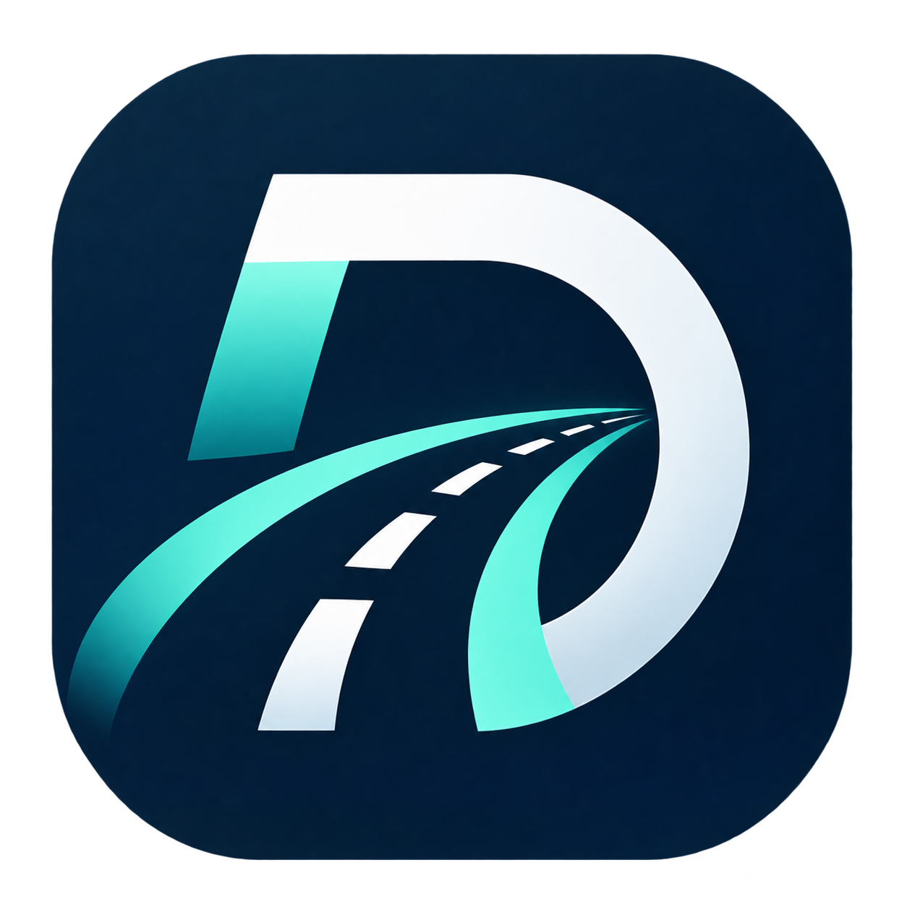
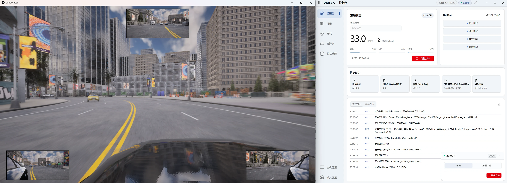

<!-- rumdl-disable MD033 MD041 -->

  
  <h1>DRISCA</h1>
  
<strong>基于 CARLA 的驾驶行为研究实验平台</strong>

  
Driving Simulator based on CARLA An Experimental Platform for Human Driving Behavior Research

  

    
    
    
  

  

    <a href="docs/index.md">文档首页</a> ·
    <a href="docs/guide/01-QuickStart.md">使用指南</a> ·
    <a href="docs/deploy/01-CarlaSourceAndPatch.md">构建与部署</a> ·
    <a href="docs/design/01-Architecture.md">系统设计</a>
  

---

DRISCA 是面向 Windows 平台的驾驶行为研究实验平台，基于 CARLA UE5 构建。操作者通过桌面管理端完成实验准备、实时控制、场景与交通流编排、录像回放与数据导出；被试在 CARLA 驾驶窗口中参与实验。

## 核心能力

- **实验编排与控制**：通过预设管理地图、车辆、天气、交通流、语音指令和实验打点；支持运行期实时干预和一键停止。
- **驾驶渲染与多视角**：主视图与三路后视镜在 CARLA Unreal 内直接渲染，支持车内视角、第三人称追尾视角和自由视角平滑切换。
- **环境与交通流**：独立组合日照与天气、添加局部球雾区域；内置背景交通流、七类交互场景事件与运行期车流调控。
- **数据记录与回放**：自动记录主车状态、背景车辆状态与实验事件到 SQLite 并支持导出 CSV；支持录像回放、环境状态同步和多视角切车观察。

## 文档导航

| 板块 | 内容 | 入口 |
| --- | --- | --- |
| **使用指南** | 面向实验操作人员，涵盖环境准备、实验流程、场景与交通流操作、数据导出与回放 | [快速开始](docs/guide/01-QuickStart.md) |
| **构建与部署** | 面向环境部署与二次开发者，涵盖 CARLA 补丁与 C++ 模块接入、打包与自定义地图包 | [CARLA 源码补丁](docs/deploy/01-CarlaSourceAndPatch.md) |
| **系统设计** | 面向开发者，涵盖系统架构、DRISCA WebSocket 接口、交通流、数据契约与路线图 | [系统架构](docs/design/01-Architecture.md) |
