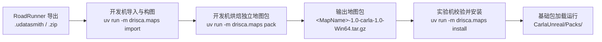

# 自定义地图与独立地图包

CARLA UE5 支持将自定义地图制作成独立的 `.tar.gz` 内容包（DLC Pack）。地图只需在开发机上用 UE 烘焙一次；实验机无需安装 Unreal Engine，只需把烘焙好的地图包安装到 Shipping 基础包中即可直接使用。

DRISCA 内置了 `drisca.maps` 命令行工具（`uv run -m drisca.maps`），统一承担 **RoadRunner `.udatasmith` 导入 → 语义归档与路网提取 → 独立地图包烘焙 → 实验机安装管理** 全流程，不依赖 MathWorks 完整的 RoadRunner C++ 插件，也不依赖 `carla` Python wheel。

## 整体流程



## 1. 仅安装与管理已有地图包（实验机操作）

如果你已经拿到了烘焙好的地图包（例如 `Singapore_Intersection-1.0-carla-1.0-Win64.tar.gz`），实验机上**不需要** Unreal Engine，也**不需要**安装 `carla` wheel 或额外复制材质插件。

若已在管理端 **主机配置** 中填好打包版 `CarlaUnreal.exe` 路径，以下命令会自动读取该服务器目录；也可以通过 `--server` 显式指定：

```powershell
# 校验并安装地图包（已安装同名包时自动覆盖）
uv run -m drisca.maps install D:/Maps/Singapore_Intersection-1.0-carla-1.0-Win64.tar.gz --server D:/CARLA/Carla-1.0-Win64-Shipping

# 查看已安装的扩展地图包
uv run -m drisca.maps list --server D:/CARLA/Carla-1.0-Win64-Shipping

# 卸载指定地图包
uv run -m drisca.maps remove Singapore_Intersection --server D:/CARLA/Carla-1.0-Win64-Shipping
```

安装完成后重启 CARLA，打开 DRISCA 管理端的 **场景** 页面，地图下拉列表中就会出现新安装的地图。

> 首次在新地图上做实验时，请在 **场景** 页面重新选择或拾取该地图内的有效道路出生点，不要沿用其他地图的坐标。

## 2. 插件与依赖边界

完整 RoadRunner C++ 插件（`RoadRunnerRuntime`、`RoadRunnerImporter`、`RoadRunnerCarlaDatasmith`）在 UE5.8 中不兼容，当前流程已完全弃用，改由 `drisca.maps` 内置的 UE Python 脚本接管 OpenDRIVE 提取、语义归类与出生点生成。各组件在导入与运行阶段的依赖边界如下：

| 依赖项 | 开发机导入阶段 | 烘焙 / 实验机运行阶段 |
| --- | --- | --- |
| `DatasmithImporter`、`PythonScriptPlugin` | **必需**（编辑器脚本与 Datasmith 导入） | 仅 Editor 使用，不进入 Shipping |
| `DatasmithContent` | **必需** | **基础包必需**（关卡仍引用其类型，DRISCA 基础 Shipping 包已启用该 Runtime 模块） |
| `RoadRunnerMaterials`（MathWorks 纯内容材质插件） | **必需**（放置于 `Unreal/CarlaUnreal/Plugins/RoadRunnerMaterials/`） | 引用的父材质会随地图自动 Cook 进 `.tar.gz` 包，实验机无需单独安装 |
| 完整 RoadRunner C++ 插件 | 不使用 | 不需要 |

> **普通地图无需接入 DRISCA C++ 补丁即可烘焙**：只要使用与 DRISCA 基础包相匹配的官方 CARLA UE5 / Content 基线与 UE 版本、启用 `DatasmithContent`、传入 DRISCA 基础包附带的 `carla-1.0-Win64-release-metadata.tar.gz`，并保证地图依赖材质完整，就可以烘焙出能直接安装到 DRISCA 预编译 Shipping 基础包中的地图包。仅当地图资产本身引用了 DRISCA 专属 C++ 类型时，才需要接入 DRISCA 源码。

## 3. 从 RoadRunner 导出并导入工程（开发机）

### 导出准备

在 RoadRunner 中选择 **Unreal Datasmith（`.udatasmith` 或 `.zip`）** 格式导出场景，保留完整的几何资源目录、材质、OpenDRIVE metadata 与语义标签。导出的文件已内嵌 OpenDRIVE 路网，无需手动配对单独的 `.xodr` 文件。

### 环境自检与导入

工具会自动从 `configs/machine.toml` 读取本地 UE 编辑器和 `CarlaUnreal.uproject` 路径（也可用 `--engine-root`、`--project`、`--carla-root` 显式覆盖）。关闭正在运行的 `UnrealEditor.exe` 后，在 DRISCA 根目录执行：

```powershell
# 1. 检查本地 UE、CARLA、必需插件与基础包 metadata
uv run -m drisca.maps doctor

# 2. 预检导出的 .udatasmith/.zip 元数据、语义与内嵌路网
uv run -m drisca.maps probe D:/Maps/Singapore_Intersection.udatasmith

# 3. 执行导入、语义归档、路网提取、出生点生成与导航烘焙
uv run -m drisca.maps import D:/Maps/Singapore_Intersection.udatasmith --map Singapore_Intersection
```

`import` 子命令会自动完成以下工作：

1. 提取内嵌 OpenDRIVE 并规范斑马线对象类型为 `crosswalk`，写入 `Content/Carla/Maps/OpenDrive/<MapName>.xodr`。
2. 以无界面模式启动 `UnrealEditor-Cmd.exe`，基于 `/Game/Carla/Maps/BaseMap/BaseMap` 创建目标关卡，通过 Datasmith 导入到 `/Game/RRImport/<MapName>`。
3. 按语义将静态网格归档至 `/Game/Carla/Static/<语义>/<MapName>/`，补充简单碰撞，并通过 `AOpenDriveActor` 生成路由与出生点。
4. 默认启动两轮 GUI 编辑器静态烘焙 Recast 行人导航并保存关卡（该步骤依赖本机引擎的 `rr.RefreshNav` / `rr.NavStats` 命令；如果使用未修改的官方引擎或无需行人导航，可附加 `--skip-nav` 跳过）。

> 导入完成后建议在 Editor 中核验关卡材质、出生点与信号灯朝向，再执行地图包烘焙。

## 4. 烘焙独立地图内容包（开发机）

烘焙时需传入与目标基础包匹配的 `release-metadata.tar.gz`：

- **面向官方 CARLA 1.0 + DRISCA 单 EXE 补丁（推荐）**：直接传入官方发布的 `CARLA_1.0_release-metadata.tar.gz`。烘焙出的地图包可直接安装到官方 CARLA 1.0 目录，且后续升级 DRISCA 单 EXE 时**无需重新烘焙地图包**。
- **面向自建三地图 Shipping 基础包**：传入对应打包产出的 `Build/Package/carla-1.0-Win64-release-metadata.tar.gz`。

> 若使用裁剪版 UE 引擎（不重新编译 AutomationTool），需确保 `Util/ContentPacks/carla_pack.py` 调用 UAT 时附带 `-nocompile` 参数。

在 DRISCA 根目录执行：

```powershell
# 面向官方 CARLA 1.0 烘焙（显式指定官方 release-metadata）
uv run -m drisca.maps pack --map Singapore_Intersection --base D:/Simulator/CARLA_1.0_release-metadata.tar.gz

# 或面向本地自建基础包烘焙（自动读取 Build/Package/ 下的 metadata）
uv run -m drisca.maps pack --map Singapore_Intersection
```

如需自定义输出目录、内容包名或显式指定 metadata 路径，可附加 `--out`、`--pack-name`、`--base`（也可先加 `--dry-run` 预览实际执行的命令）。

构建完成后会生成 `<MapName>-1.0-carla-1.0-Win64.tar.gz`（内含 `carla-pack.json` 校验清单、Pak/UTOC/UCAS 容器、XODR 与所需材质）。将其分发到实验机，按第一节执行 `install` 安装即可。
