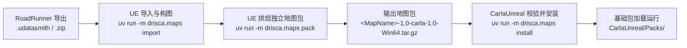

# 自定义地图与独立地图包

CARLA UE5 支持将自定义地图制作成独立的 `.tar.gz` 内容包（DLC Pack）。地图通过 Unreal Engine 烘焙一次后，直接安装到 `CarlaUnreal` 的 Shipping 目录即可加载使用。

DRISCA 内置 `drisca.maps` 命令行工具（`uv run -m drisca.maps`），覆盖 **RoadRunner `.udatasmith` 导入 → 语义归档与路网提取 → 独立地图包烘焙 → 地图包安装管理** 全流程。

## 整体流程



## 1. 安装与管理已有地图包

拿到烘焙好的地图包（例如 `CustomMap-1.0-carla-1.0-Win64.tar.gz`）后，直接执行安装即可。

若已在管理端 **主机配置** 中填好独立发布版 `CarlaUnreal.exe` 路径，以下命令会自动读取该服务器目录；也可以通过 `--server` 显式指定：

```powershell
# 校验并安装地图包（已安装同名包时自动覆盖）
uv run -m drisca.maps install D:/Maps/CustomMap-1.0-carla-1.0-Win64.tar.gz --server D:/CARLA/Carla-1.0-Win64-Shipping

# 查看已安装的扩展地图包
uv run -m drisca.maps list --server D:/CARLA/Carla-1.0-Win64-Shipping

# 卸载指定地图包
uv run -m drisca.maps remove CustomMap --server D:/CARLA/Carla-1.0-Win64-Shipping
```

安装完成后重启 CARLA，打开 DRISCA 管理端的 **场景** 页面，地图下拉列表中就会出现新安装的地图。

> 首次在新地图上做实验时，在 **场景** 页面重新选择或拾取该地图内的有效道路出生点。

## 2. 插件与依赖说明

`drisca.maps` 内置 UE Python 脚本，直接完成 OpenDRIVE 提取、语义归类与出生点生成。各阶段组件依赖如下：

| 依赖项 | UE 导入阶段 | 烘焙与运行阶段 |
| --- | --- | --- |
| `DatasmithImporter`、`PythonScriptPlugin` | **必需**（编辑器脚本与 Datasmith 导入） | 仅 Editor 使用 |
| `DatasmithContent` | **必需** | **基础包必需**（关卡引用其 Runtime 类型） |
| `RoadRunnerMaterials`（MathWorks 纯内容材质插件） | **必需**（放置于 `Unreal/CarlaUnreal/Plugins/RoadRunnerMaterials/`） | 引用的父材质随地图自动 Cook 进 `.tar.gz` 包 |

> 普通自定义地图只需使用与目标基础包匹配的 CARLA UE5 / Content 基线与 UE 版本、启用 `DatasmithContent` 并传入对应 `release-metadata.tar.gz` 即可烘焙。

## 3. 从 RoadRunner 导出并导入 UE 工程

### 导出准备

在 RoadRunner 中选择 **Unreal Datasmith（`.udatasmith` 或 `.zip`）** 格式导出场景，保留完整的几何资源目录、材质、OpenDRIVE metadata 与语义标签。导出的文件已内嵌 OpenDRIVE 路网。

### 环境自检与导入

工具会自动从 `configs/machine.toml` 读取本地 UE 编辑器和 `CarlaUnreal.uproject` 路径（也可用 `--engine-root`、`--project`、`--carla-root` 显式覆盖）。关闭正在运行的 `UnrealEditor.exe` 后，在 DRISCA 根目录执行：

```powershell
# 1. 检查本地 UE、CARLA、必需插件与基础包 metadata
uv run -m drisca.maps doctor

# 2. 预检导出的 .udatasmith/.zip 元数据、语义与内嵌路网
uv run -m drisca.maps probe D:/Maps/CustomMap.udatasmith

# 3. 执行导入、语义归档、路网提取、出生点生成与导航烘焙
uv run -m drisca.maps import D:/Maps/CustomMap.udatasmith --map CustomMap
```

`import` 子命令会自动完成以下工作：

1. 提取内嵌 OpenDRIVE 并规范斑马线对象类型为 `crosswalk`，写入 `Content/Carla/Maps/OpenDrive/<MapName>.xodr`。
2. 以无界面模式启动 `UnrealEditor-Cmd.exe`，基于 `/Game/Carla/Maps/BaseMap/BaseMap` 创建目标关卡，通过 Datasmith 导入到 `/Game/RRImport/<MapName>`。
3. 按语义将静态网格归档至 `/Game/Carla/Static/<语义>/<MapName>/`，补充简单碰撞，并通过 `AOpenDriveActor` 生成路由与出生点。
4. 默认启动两轮 GUI 编辑器静态烘焙 Recast 行人导航并保存关卡（依赖引擎内的 `rr.RefreshNav` / `rr.NavStats` 命令；使用未修改的 UE 引擎或跳过行人导航时，附加 `--skip-nav`）。

> 导入完成后建议在 Editor 中核验关卡材质、出生点与信号灯朝向，再执行地图包烘焙。

## 4. 烘焙独立地图内容包

`drisca.maps pack` 内置自包含的 UAT 单图烘焙与打包流程，默认仅烘焙指定单张地图，全程在 DRISCA 的 `uv` Python 环境中执行。

烘焙时传入与目标基础包匹配的 `release-metadata.tar.gz`：

- **面向官方 CARLA 1.0 + 单 EXE 补丁**：传入官方发布的 `CARLA_1.0_release-metadata.tar.gz`。烘焙出的地图包可直接安装到官方 CARLA 1.0 目录，后续升级单 EXE 后可直接继续使用。
- **面向自建三地图 Shipping 基础包**：传入对应打包产出的 `Build/Package/carla-1.0-Win64-release-metadata.tar.gz`。

在 DRISCA 根目录执行：

```powershell
# 面向官方 CARLA 1.0 烘焙（显式指定官方 release-metadata）
uv run -m drisca.maps pack --map CustomMap --base D:/Simulator/CARLA_1.0_release-metadata.tar.gz

# 或面向本地自建基础包烘焙（自动读取 Build/Package/ 下的 metadata）
uv run -m drisca.maps pack --map CustomMap
```

如需自定义输出目录、内容包名或显式指定 metadata 路径，可附加 `--out`、`--pack-name`、`--base`（也可先加 `--dry-run` 预览实际执行的命令）。

构建完成后会生成 `<MapName>-1.0-carla-1.0-Win64.tar.gz`（内含 `carla-pack.json` 校验清单、Pak/UTOC/UCAS 容器、XODR 与所需材质）。按第一节执行 `install` 安装到 `CarlaUnreal` 目录即可。
