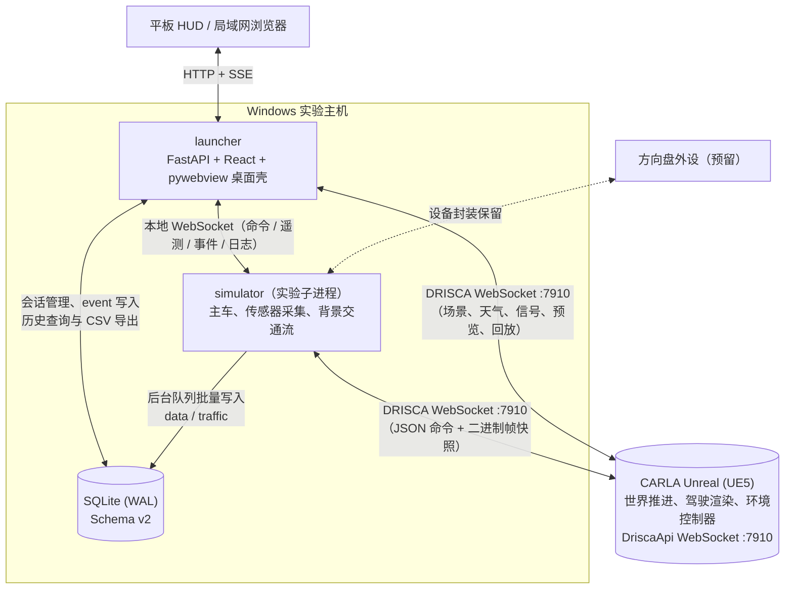
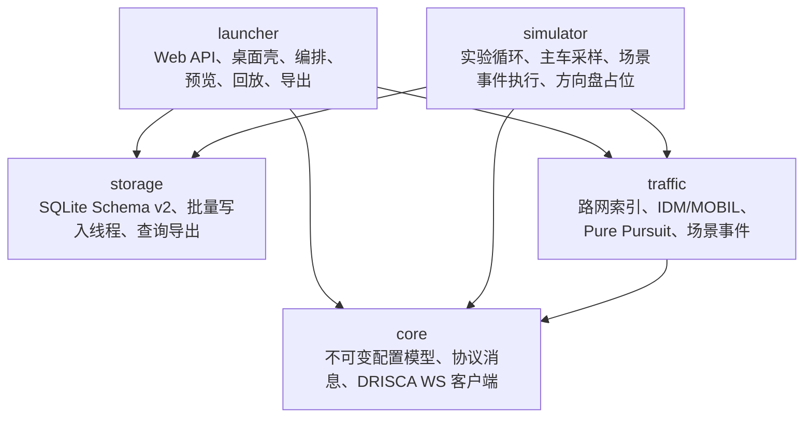

# 系统架构

DRISCA 是基于 CARLA UE5 的 Windows 驾驶行为研究实验平台，采用“桌面管理端 + 实验采样子进程 + CARLA DrivingView 模块”的多进程架构，通过本地 WebSocket 通道协同完成实验编排、驾驶仿真、背景交通流控制与数据落盘。

## 进程与通信拓扑

### 各进程职责

- **`launcher`（管理端父进程）**：提供无边框桌面管理窗口与内置 FastAPI 服务（默认 `0.0.0.0:7900`）。负责主机/输入/预设配置管理、CARLA 启停与连接监管、场景与天气预检、交通流预览、录像回放调度、平板 HUD 推送、子进程生命周期管理以及实验数据查询与 CSV 导出。
- **`simulator`（实验子进程）**：由 `launcher` 以 `sys.executable -m drisca.simulator` 启动并纳入 Windows Job Object（父进程异常退出时自动回收）。负责持有当前实验会话，驱动主车与背景交通流（`traffic`），通过 DRISCA WebSocket 接口与 CARLA 进行帧同步交换（`exchange`），并将主车与背景车状态批量写入 SQLite，同时按 20–30 Hz 向 `launcher` 推送遥测快照。
- **CARLA Unreal（UE5 仿真端）**：在引擎内直接完成三维世界物理推进、主视图与三路后视镜渲染、键盘连续驾驶输入、全局/局部环境渲染以及 CARLA 录像录制/回放，通过内嵌的 Boost.Beast WebSocket 服务（默认 `127.0.0.1:7910/drisca/v1`）向 Python 侧暴露控制与二进制快照接口。

## 代码包结构与依赖方向

源码包位于 `src/drisca/`，划分为五个业务子包，依赖严格单向：

- `core` 与 `storage` 彼此独立，不依赖上层业务包。
- 模块导入阶段只做类型与函数定义；连接 CARLA、打开数据库、读取外部配置、启动后台线程和监听端口全部在显式启动流程中执行。
- 内部计算与数据库落盘速度单位统一为 `m/s`，界面展示层按需乘以 `3.6` 转为 `km/h`；接入 CARLA 的道路限速（`km/h`）时统一除以 `3.6`。

## 为何在 UE 端直接渲染驾驶视图

早期原型曾尝试“CARLA 服务端渲染相机传感器 → GPU 回读至 CPU 内存 → TCP 传输裸 BGRA 像素 → Python `pygame-ce` 窗口合成”。实测在 1080p 主视图 + 3 路后视镜（60 Hz）下，单帧原始像素达 `9.1 MB`（每秒超过 `500 MB` 本地回环搬运），服务端渲染线程在 `ReadSurfaceData` 同步回读处严重阻塞世界推进帧率。

当前主线将主视图、三路后视镜 HUD 与键盘连续控制整体下沉至 CARLA UE5 `DrivingView` 模块：画面零回读、零跨进程像素拷贝，Python 侧仅通过 JSON 命令与紧凑二进制快照（约数 KB/帧）完成控制与采样，且实验运行完全脱离官方 `carla` Python wheel 依赖。

## 正常停机与错误处理原则

平台面向小规模受控实验环境，采用 **尽早失败（Fail-Fast）** 原则：端口占用、CARLA 断连、配置错误、道路位置无效、数据库版本不匹配或写入队列溢出时直接报错，并由 `launcher` 展示完整日志。

正常停止实验时，按顺序完成剩余数据行提交、离散事件与日志刷新、驾驶视图停止、场景车辆清理、子进程回收与数据库会话收尾。
