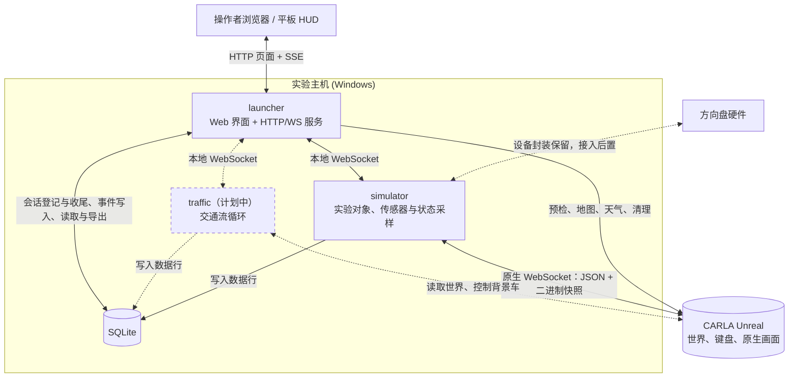
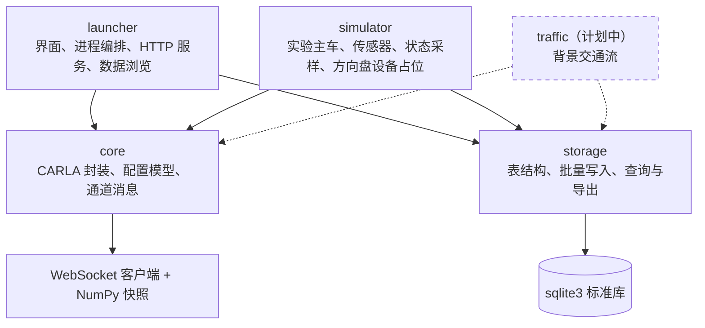
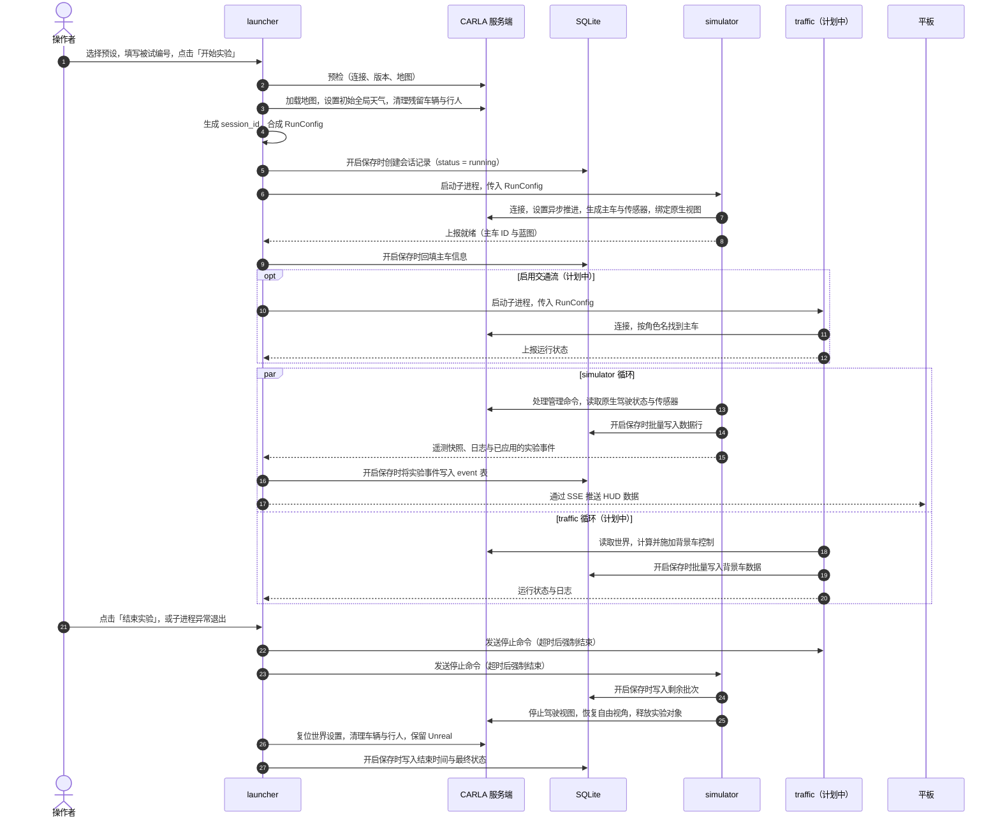
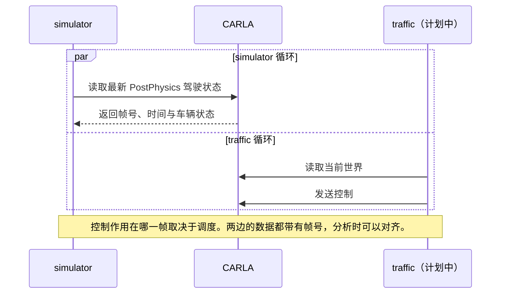
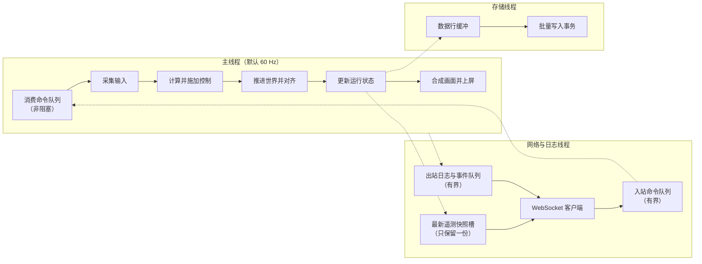

# 系统架构

> 交通流（`traffic`）列入后续计划。本文保留其设计，实现安排见 [开发路线图](./06-Roadmap.md)。

DRISCA 由一个父进程和若干子进程组成。管理端 `launcher` 通过 Web 界面负责实验前后的准备、子进程的启动与监管、平板页面、数据面板、调试面板、按键说明，以及实验数据的读写。`simulator` 是实验采样子进程，管理主车与传感器，并通过原生驾驶接口读取状态。Unreal 异步推进世界、处理键盘连续控制并直接渲染画面。`traffic` 是背景交通流循环（计划中）。它们与 CARLA 服务端、同一个 SQLite 数据库协同工作。

`simulator` 按世界帧号采集新状态，`launcher` 处理界面操作和网络消息。Unreal 的驾驶输入与画面更新独立运行。

当前原生 API、Python 客户端、自有环境控制（全局天气及局部球雾）与自研交通模块第一阶段（主车自动驾驶：车道图索引、路线跟踪、速度控制与信号灯响应）均已接入并完成单车实机验证。背景车交通流与双终端列入后续阶段，方向盘接入等待硬件。

## 术语

全文使用以下名称。

| 术语 | 含义 |
| --- | --- |
| 操作者（operator） | 在管理端控制台上准备、监控和控制实验的人员 |
| 被试（subject） | 在 `simulator` 驾驶台前参与实验的驾驶人 |
| 子进程（worker） | 由 `launcher` 启动的 `simulator` 与 `traffic` |
| 会话（session） | 一次实验，对应 `session` 表中的一行 |
| 运行配置（RunConfig） | 一次会话实际使用的完整配置，启动前由 `launcher` 合成 |
| 预设（preset） | 方案配置的文件形式，保存在 `configs/presets/` 目录 |
| 遥测快照（telemetry snapshot） | `simulator` 每隔数帧上报一次的运行状态 |
| HUD 数据 | 从遥测快照中挑出、推送到平板的子集 |
| 数据面板 | `launcher` 桌面端中实时显示遥测快照的区域 |
| 调试面板 | `launcher` 中供操作者调整运行状态、相机和出生点的功能，按归属分布在实验控制、方案配置和主机配置页 |
| 按键说明 | `launcher` 输入配置中展示的操作按键对照表 |
| 世界帧（frame） | CARLA 世界每推进一次的编号 |

## 进程与通信

`launcher` 管理 Unreal 与实验子进程，并提供操作者页面和业务接口。它在同一个 HTTP 服务中承载操作者控制台、平板 HUD、页面接口与 SSE，以及子进程的本地 WebSocket 接入。`simulator` 与 `traffic` 不开放端口，由 `launcher` 以 `sys.executable -m` 启动，启动后主动连回 `launcher`。

运行期的通道是本地 WebSocket，承载三类内容：下行的控制命令，上行的遥测快照、日志和状态，以及子进程在执行操作后上报的实验事件。主视图与后视镜画面保留在 Unreal 内。worker 另行连接原生 WebSocket 接口，读取最新状态并调整视图。

`launcher` 同时通过操作系统的 `stdout` 与 `stderr` 管道捕获子进程的输出和退出码。子进程即使在连上 WebSocket 之前因底层扩展或环境问题崩溃，错误输出也能保留下来。

`launcher` 与子进程的生命周期关系是：子进程由 `launcher` 启动，接受 `launcher` 的停止命令，退出后由 `launcher` 完成收尾。子进程加入 Windows Job Object，`launcher` 异常退出时，操作系统会一并结束这些子进程。驾驶端由管理端传入运行配置后启动，并连接管理端。

## 代码分层与依赖

代码划分为五个顶层子包。每个可运行的进程都有包内的 `__main__.py` 作为入口。

依赖只能从上往下指，`import` 不能反向。几条具体约束如下。

`core` 提供原生 WebSocket 客户端、NumPy 快照解码和共享的配置、协议模型。`simulator` 编排主车、视图、采集与存储；车辆创建、传感器计算和道路查询通过接口在 Unreal 内执行。

`storage` 是数据库的唯一入口，负责表结构、版本校验、批量写入、查询和导出。它只依赖标准库 `sqlite3`，不导入 `carla`、硬件或界面框架。CARLA 的原生对象要先投影成扁平的行结构，才能交给 `storage`。

`simulator` 从原生车辆记录与研究记录生成数据行和遥测快照。键盘及画面由 Unreal 处理；`wheel_device.py` 保留方向盘设备访问与回正力，硬件接入后继续由 simulator 管理。

`launcher` 由 Python 后端与 Web 界面组成。后端承载 HTTP、SSE 和子进程 WebSocket；桌面使用 pywebview 无边框窗口加载同一套页面。实验编排使用标准库 `subprocess` 管理子进程，Windows Job Object 管理父子进程退出关系。前后端通信见[管理端前后端通信](./10-LauncherWeb.md)。

模块被导入时不做任何外部操作：不连接 CARLA，不初始化方向盘，不打开数据库，不启动线程，不监听端口。这些动作只在入口函数被显式调用时发生。

## 配置

文件填写与示例见[配置管理](../guide/05-Configuration.md)，模型与读写约定见[配置模型](./08-ConfigurationModels.md)。

配置按生命周期分为三份配置文件、单次实验设置和代码内的模块常量。每一层只保存自己的内容。

| 层级 | 包含内容 | 来源 |
| --- | --- | --- |
| 机器配置（`MachineConfig`） | CARLA 地址与端口、显示器分辨率与全屏、服务端口、语音与调试开关、数据库与录像路径 | `configs/machine.toml`，每台机器设置一次 |
| 输入配置（`ControlConfig`） | 键盘与方向盘的动作到按键名称绑定、方向盘硬件开关 | `configs/control.toml`，按外设方案保存，不同机器若方向盘相同可直接复用 |
| 实验预设（`PresetConfig`） | 地图、全局天气与初始局部球雾、主车与出生点、四路相机的安装位置与视野、同步模式 | `configs/presets/*.toml`，在方案配置的场景与车辆、相机安装、指令与打点标签编辑；运行期可应用相机与全局天气调整，并保存到当前预设 |
| 实验设置（`RunSettings`） | 被试编号、本次备注、保存总开关与 Recorder 选项 | 被试编号在控制台填写，保存选项在预设对话框设置，备注在结束实验时填写 |
| 模块常量 | Unreal 中的键盘响应系数、core 中的 FKey 映射与 simulator 中的方向盘轴号映射 | 代码中的具名常量 |

启动实验时，`launcher` 读取机器配置、输入配置和所选预设，并结合本次填写的实验设置，合并、校验后生成不可变的 `RunConfig`，其中包含本次会话的 `session_id` 与数据库文件绝对路径 `db_path`。`RunConfig` 有两个去处：开启保存时以 JSON 文本存入 `session` 表，同时写到 `.cache/run/<session_id>.json` 交给子进程；调试运行只使用临时传递文件。子进程通过 `--config` 读取这份文件，并把它反序列化为冻结的对象，显式传给各个子模块。

派生值（例如按窗口分辨率算出的主视图实际像素尺寸）保存在运行时的上下文中，不回写配置对象。因此，同一份 `RunConfig` 不会在运行中与会话记录产生偏差。

## 一次实验的过程

实验开始和结束时，`launcher` 自动清理场景中的全部车辆与行人；操作者也可手动清理。`simulator` 在退出时销毁主车传感器。

会话编号由 `launcher` 生成，并随启动配置交给子进程。会话行由 `launcher` 写入，包括创建、回填主车信息、结束时的状态。数据行由子进程写入。

碰撞与压线按每次传感器回调生成事件，与其他事件一起写入 event 表。

实验中需要记录的事件，例如自动驾驶与接管的切换、档位与手刹、车灯、后视镜显隐、镜头调整、天气变化，都由执行该操作的进程在应用之后上报。

`launcher` 发出的远程命令（如切换自动驾驶、调整相机、切换天气）不直接写入事件表。`simulator` 收到命令并应用成功后，上报一条实验事件，触发源记为 `launcher`。命令与事件分开，事件表只记录实际生效的操作，同一个操作也只记录一次。

`launcher` 把子进程上报的事件与自身产生的事件（实验开始与结束、子进程状态变化、打点标记）一起写入事件表 `event`。事件表将帧号、时间戳、事件分类、事件名与触发源拆为独立列，同时用 `payload_json` 保存结构化详情。连续控制（油门、刹车、转向）不作为事件记录。

正常停机时，子进程先停止主循环，等待存储线程提交剩余数据，再发送完剩余日志与事件并关闭 WebSocket 后退出。`launcher` 等待子进程退出及已接收事件入库，复位 CARLA 世界并清理对象，最后写入实验结束事件，将会话标记为 `committed`。

一组实验结束时，Launcher 先完成实验子进程和数据库收尾，再关闭本次持有的 Unreal。单次实验结束保留 Unreal，供下一次实验重新创建车辆和绑定驾驶视图。

最终状态分为两种。正常结束时写为 `committed`。子进程异常退出或实验被中止时写为 `aborted`。`launcher` 启动时还会把上次遗留的 `running` 会话统一标记为 `aborted`，因此不会出现长期停留在运行中的记录。

控制连接意外断开时，Unreal 停止驾驶视图并恢复默认自由视角，Python 按实验异常退出，Launcher 将会话记为 `aborted`。普通调参连接断开只释放对应连接。

## 世界推进与帧对齐

显示目标帧率由机器配置的 `target_fps` 指定，Unreal 异步推进世界。Python 读取最新状态，每个采到的世界帧最多保存一行。帧与事件保存发生时的时间戳，会话记录开始和结束时间，具体字段见[运行状态与实验数据](./02-DataStructures.md)。

驾驶状态在 Unreal 的 PostPhysics 汇总，帧号、世界时间、墙钟时间、位姿和速度来自同一次采样。Python 按 `frame_no` 丢弃重复读取，研究块包含 IMU/GNSS 及各自采样时刻。主视图与后视镜由原生渲染链路更新。

原生异步世界保持可变帧步长，FixedDeltaSeconds 处于未设置状态。物理子步按 simulation_fps 的最大间隔划分，并以最多覆盖 0.2 秒世界帧的子步数执行。仿真时间取当前世界 GetTimeSeconds，地图加载后重新起算，与原生传感器时间一致。

`traffic` 从不推进世界，只通过 `wait_for_tick()` 或读取世界状态来跟随。它与 `simulator` 是两个进程，没有共享的调度。因此，`traffic` 的控制作用在哪一帧，取决于两个进程的调度时机，不一定固定为下一帧。

每条数据行都带有世界帧号和时间戳，分析时 `simulator` 与 `traffic` 的数据依靠帧号对齐。交通流不要求精确到某一帧，少量帧的偏移可以接受，只要每条记录的帧号正确即可用于分析。

## 遥测、HUD、数据面板与调试面板

`simulator` 每隔数帧上报一次遥测快照，频率约为 20 至 30 Hz。快照包含车辆的运动、控制、位姿、道路和传感器状态。快照经过 WebSocket 发给 `launcher`，`simulator` 自身不做任何文字绘制。

`launcher` 收到快照后，用于桌面数据面板和平板 HUD。

数据面板位于桌面端的控制台，显示完整的遥测内容，供操作者观察车辆状态。

平板 HUD 显示车速、限速、挡位、转向、驾驶模式。这些字段由 `launcher` 从快照中挑出，通过 SSE 推送给平板。平板不读取数据库，因此即使方案配置为「不保存数据」，HUD 依然可以工作。

操作者在控制台触发语音、接管请求和其他现场操作。自动触发功能随具体实验需求加入。

运行控制位于控制台页，负责接管、天气、语音和打点，自动驾驶入口保留并明确提示当前状态。方案配置的相机安装标签负责四路相机位姿与视野，主机配置的驾驶显示标签负责后视镜布局与显隐。方案配置页负责预设管理，并支持从最新遥测拾取出生点。

调整相机时，`launcher` 发送 `UpdateCameraCommand`，`simulator` 应用后上报 `UpdateCameraEvent`，再由 `launcher` 在开启保存时写入事件表。调好后，操作者可以保存到当前预设，供后续实验使用。预设页只用于实验前的静态配置编辑。

按键说明与控制绑定统一位于输入配置页。输入配置中的键盘按键与方向盘按钮，由 `launcher` 读取并展示为对照表，同时随运行配置交给 `simulator`。Unreal 窗口负责显示驾驶画面。

平板只连接 `launcher` 的一个地址。如果 `launcher` 没有收到快照超过设定时间，它会向平板广播重置状态，避免界面停留在旧数值上。

遥测快照与数据行是两条独立的路径。数据行由存储线程高频、完整地写入数据库。遥测快照只保留最新一份，约 20 至 30 Hz 发给 `launcher` 用于显示，不写入数据库。

## 存储

所有实验数据保存在一个 SQLite 文件中，使用 WAL 模式、`synchronous = NORMAL` 和 `busy_timeout = 5000`。

会话表（`session`）每次实验一行，记录会话编号、被试编号、起止时间、应用版本、结构版本、状态、主车信息、备注和完整的运行配置。被试编号由 `launcher` 管理，同一个库内每次实验靠会话编号隔开。结束时间和主车信息在会话开始时尚不存在，因此这些列允许为空。状态取值为 `running`、`committed`、`aborted`。

数据表（`data`）保存主车的运动状态、驾驶人输入、车辆实际控制和连续传感器数据，按会话编号和世界帧号建立索引。交通流表（`traffic`）属于 后续规划，同样按会话编号、世界帧号和车辆编号建立索引。

子进程的数据写入由后台线程攒批完成，每满 500 行或每 0.5 秒提交一次。每批用 `BEGIN IMMEDIATE` 开启短事务并执行批量插入。事务持有写锁的时间很短，多个进程争用时按 `busy_timeout` 等待。等待超时或写入失败时记录错误并退出，`launcher` 展示日志，操作者联系开发者处理。

“保存数据”开关控制整次运行的实验数据写入。关闭时，管理端跳过会话与事件数据库操作，驾驶端跳过存储线程与 Recorder，实时界面和日志照常显示。临时运行配置在调试结束后删除。

结构版本由 `PRAGMA user_version` 记录。启动时如果数据库版本与代码中的 `SCHEMA_VERSION` 不一致，程序直接报错退出，日志中说明处置方式（删除测试库，或运行一次性迁移脚本）。程序不会自动改表。

事件表（`event`）记录实验中发生的事件，按会话编号、世界帧号和时间建立索引。数据库读取和导出由 `launcher` 完成，导出的 CSV 按数据库的列名与顺序输出，不另做格式转换。管理端按所选会话编号导出 `sessions.csv`、`data.csv` 和 `events.csv`，通过 `session_id` 关联，文件写入实验主机配置的导出目录。

`launcher` 负责写入会话表和事件表。数据行只由产生数据的子进程写入。

## 线程模型

`simulator` 主线程以约 20 Hz 执行 exchange，依次处理命令、读取完整原生快照、投影数据与发布遥测。原生连接使用 websockets 同步客户端；worker 到 Launcher 的消息与日志由独立线程处理，数据库由后台存储线程写入。Unreal 异步推进世界，原生 API 在游戏线程推进异步 Beast 操作、应用命令与采样。

主线程与网络线程之间通过有界结构交换数据：遥测快照槽只保留一份，命令队列与日志队列有界。主线程写入遥测快照槽时只替换引用，不等待网络发送。命令队列在主线程中只做非阻塞读取。队列满时直接报错退出，由开发者排查设计。

数据行的写入不经过上述结构。主线程把数据行交给存储线程的缓冲，存储线程批量提交。

## 版本与依赖的边界

应用版本只在 `pyproject.toml` 中维护。结构版本只由存储层维护。两者互不影响。

本项目只支持最新版本。旧数据、旧接口、旧配置项不做兼容处理，不兼容时直接报错，并在日志中说明原因和处置方式。

配置目录集中在 `configs/`，数据库和录像位于 `data/`。正常关闭时提交剩余数据并完成事件发送。启动配置和运行期调整事件共同描述本次实验条件。
