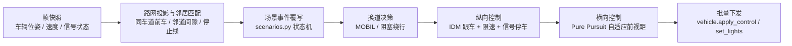

# 交通流系统

`src/drisca/traffic/` 实现了完全脱离 CARLA 官方 Traffic Manager 的 Python 侧背景交通流与主车自动驾驶控制模块，同时服务于正式实验（由 `simulator` 驱动）和独立交通流预览（由 `launcher` 驱动）。

## 模块结构

| 文件 | 职责 |
| --- | --- |
| `road_graph.py` | 缓存 `DriscaApi` 返回的道路拓扑、车道中心线、路口连接与信号触发区，提供空间邻近查询与路径搜索 |
| `controller.py` | 单车纵向跟车（IDM）、换道决策（MOBIL / 间隙模型）、横向 Pure Pursuit 转向与信号灯停车控制 |
| `styles.py` | 四类驾驶风格参数（`balanced`、`aggressive`、`conservative`、`sluggish`）及截断正态分布多样性扰动 |
| `manager.py` | `TrafficManager` 主循环：批量生成、主车周边活动交通圈（`active_radius_m`）远距回收、运行期车流数量调节、开放地图掉落重生与每帧控制 |
| `scenarios/` | 运行期七类交互场景事件与车流调控的上下文封装、装饰器注册表（`base.py`、`vehicles.py`、`flow.py`） |

## 控制管线

每帧 `exchange` 收到全场景车辆快照和信号灯状态后，`TrafficManager` 按以下管线生成每辆受控车的控制量：

### 关键稳定性设计

- **车速与驾驶风格自适应探测 + 弯道走廊分级制动**：前车与障碍物探测距离随车速与单车风格参数（`time_headway_s`、`comfort_decel`）动态扩展（48–110 m），沿前方 `RoutePath` 弯道走廊覆盖同向、静止及逆行占道车辆；远距由跟驰模型按舒适减速度平滑预判减速，碰撞时间（TTC）或间距进入紧急制动区间时直接触发急停。
- **主车周边活动交通圈与动态调量**：以主车位置和 `active_radius_m` 为边界自动回收远离主车的背景车并在主车周边道路补充，支持运行期平滑增减目标车流规模（`adjust_target_count`）。
- **目标车道锁定换道**：`LocalRoutePlanner.switch_lane` 锁定目标车道并直接投影至目标车道中心线，直至车身横向距离进入目标车道（≤ 0.8 m）后释放，避免换道中途被原车道 `road_id/lane_id` 拉回。
- **急弯自适应前视距**：Pure Pursuit 根据当前车速与前方曲率动态收紧前视距离，避免低速小半径转弯切角冲上人行道。
- **障碍物感知与实线阻塞绕行**：前车检测覆盖同车道静止故障车与低速障碍；当本车道被静止故障车长期阻挡且邻道存在安全间隙时，允许受控车临时跨越实线绕行，防止整条道路死锁。
- **生成高度、初速度与开放地图保护**：车辆生成时在道路表面基础上抬高 `Z + 0.5 m` 防止初始穿地，并支持传入 `initial_speed_mps` 带初速度生成；每帧检测已消失车辆并同步清理控制记录，对坠落（`z < -20 m`）或严重侧翻（`|pitch|` 或 `|roll| > 75°`）的车辆批量销毁，开启 `auto_respawn` 时自动在安全点补足车流规模。

## 驾驶风格与多样性

通过 `[traffic.style_counts]` 分别配置四种风格的车辆数量，`diversity`（0–1）控制同风格车辆内部的参数离散度（基于截断正态分布，并受 `seed` 确定性控制）：

| 风格 | 特征倾向 |
| --- | --- |
| `balanced` | 标准限速巡航、适中车头时距与常规变道阈值 |
| `aggressive` | 更高期望车速、更小跟车时距、更积极变道与更强加减速 |
| `conservative` | 偏低期望车速、较大安全车距、保守变道 |
| `sluggish` | 较低巡航车速、平缓加速与较长反应裕度 |

## 交互场景事件（`scenarios/`）

七类场景事件与运行期车流数量调节以强类型处理器注册在 `src/drisca/traffic/scenarios/` 中，执行时临时接管目标车辆或信号灯，结束后自动交还正常交通流控制，并在 `launcher` 侧记录对应实验事件：

1. `lead_hard_brake`（前车急刹）：筛选主车前方同车道近距前车施加紧急制动并点亮刹车灯。
2. `adjacent_cut_in`（邻车加塞）：支持复用邻道已有车立即切入，或在前方邻道带初速度生成车辆并在主车接近至近距触发阈值时加塞切入。
3. `rear_overtake`（后车超车）：不受道路限速限制，复用或后方带初速度生成车辆变道加速超越主车，拉出安全前距后切回主车车道。
4. `lead_breakdown`（前车故障）：复用前车停驶开双闪，或在前方同车道远距生成低速/静止障碍车。
5. `ahead_signal_change`（前方信号变灯）：定位主车前方即将到达的信号灯并强制切换相位。
6. `dual_lane_slowdown`（双车道缓行）：协同降低主车前方双车道车辆目标车速制造拥堵波。
7. `red_light_runner`（闯红灯车辆）：在前方路口横向车道触发车辆无视红灯穿行。

## 自定义扩展事件

DRISCA 的实验指令与交通场景事件采用装饰器注册与前端自动发现机制，新增自定义事件只需按以下三步编写 Python 代码，前端 UI 会自动渲染对应的参数表单与触发按钮：

1. **定义动作枚举与参数模型**（`src/drisca/core/traffic_models.py`）：在 `TrafficAction` 中新增枚举项，并定义对应的冻结 Pydantic `BaseModel` 参数模型，加入 `TrafficActionParams` 联合类型。
2. **注册交通场景处理器**（`src/drisca/traffic/scenarios/`）：在 `vehicles.py`、`flow.py` 或新文件中编写处理器函数，使用 `@register_traffic_action(TrafficAction.YOUR_ACTION, params_model=YourParams)` 装饰，接收 `(ctx: ScenarioContext, params: YourParams)` 并返回 `ScenarioResult`。
3. **注册管理端指令元数据**（`src/drisca/launcher/commands.py`）：使用 `@register_command(...)` 声明 `command_id`、名称、描述、分类（`weather` / `traffic` / `ego` / `custom`）、`params_model` 与 `fields` 字段清单。启动后，管理端通过 `/api/bootstrap` 下发已注册指令列表，前端按 `category` 和 `fields` 自动生成配置表单与快捷触发入口（纯管理端或天气/语音类自定义事件只需完成第 3 步）。
