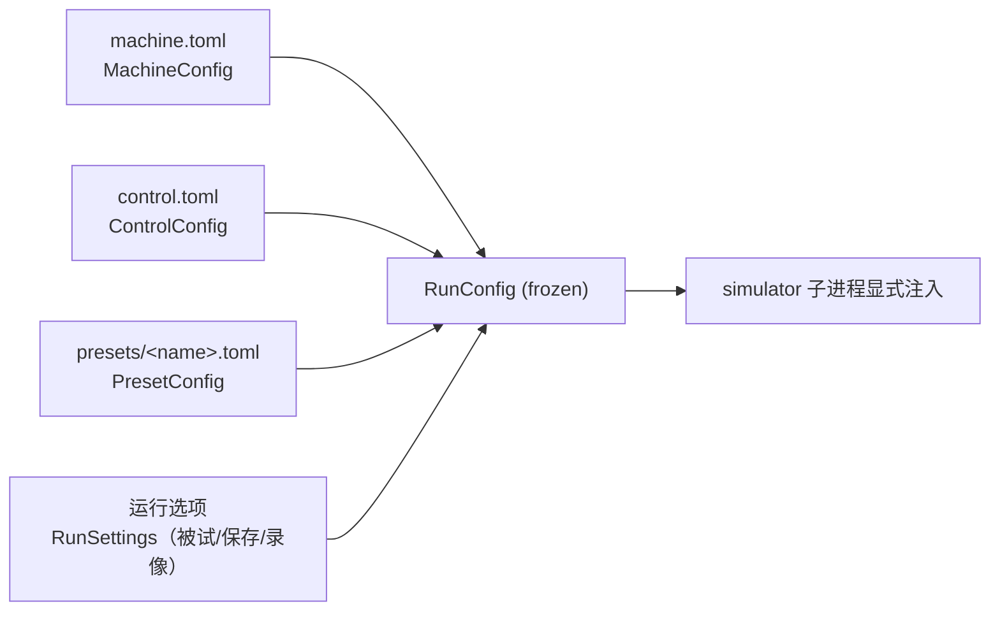

# 配置、协议与数据契约

DRISCA 的全部配置与进程间协议采用不可变模型（`pydantic.BaseModel(frozen=True)`），数据库行使用 `@dataclass(slots=True, frozen=True)`，枚举使用 `StrEnum` 或 `IntEnum`，可空字段统一使用 `| None` 并映射为 SQLite `NULL`。

## 配置分层与合成

外部配置集中存放在仓库根目录的 `configs/`，在启动实验前由 `launcher` 合成为一份不可变 `RunConfig` 写入 `.cache/run/`，再以命令行参数路径注入 `simulator` 子进程：

- **`MachineConfig`**：数据库/录像/导出目录、CARLA 连接与运行程序路径（`editor` / `packaged`）、驾驶窗口分辨率与位置、三路后视镜屏幕布局、管理端监听端口与 TTS/调试开关。
- **`ControlConfig`**：键盘按键绑定与方向盘按键绑定（预留）。
- **`PresetConfig`**：地图与同步频率、全局天气与局部球雾区域、主车车型/出生点/限速、相机安装参数、交通流风格数量与多样性、实验指令与打点列表。

## 进程间通信协议

`launcher` 与 `simulator` 之间通过本地 WebSocket（`/ws/worker`）通信，消息结构定义在 `src/drisca/core/protocol.py`：

- **下行命令（`launcher` → `simulator`）**：停止实验、切换视角（`free / cockpit / chase`）、切换自动驾驶/接管、更新天气或局部雾、触发阵雨、调节周边车流数量、触发七类交通场景事件、调试标注等。
- **上行遥测快照（`simulator` → `launcher`）**：与数据库落盘独立运行，仅保留最新一份，按约 20–30 Hz 推送给管理端数据面板与平板 HUD。
- **上行离散事件与日志（`simulator` → `launcher`）**：控制动作实际应用后上报事件，由 `launcher` 统一写入数据库 `event` 表；子进程日志经 WebSocket 结构化回传，未连接前或崩溃时的 stderr Traceback 由父进程聚合成单条 `ERROR` 日志（附完整 `detail`）展示。

## SQLite 持久化（Schema v2）

数据存储模块位于 `src/drisca/storage/`，仅依赖 Python 标准库 `sqlite3`：

- **连接与并发**：启用 `WAL` 模式；启动时严格校验 `PRAGMA user_version == 2`，版本不匹配直接终止启动并提示备份旧库。
- **独立批量写入线程**：`simulator` 将每帧投影得到的 `DataRow` 与 `TrafficRow` 放入有界队列，由后台写入线程按短事务批量提交，队列满直接报错退出。

### 数据表概览

| 表名 | 写入方 | 核心内容 |
| --- | --- | --- |
| `session` | `launcher` | 实验会话元数据：会话 ID、被试编号、预设名、地图名、起止时间、状态、录像路径、实验备注 |
| `data` | `simulator` | 主车逐帧研究数据：帧号、仿真/系统时间、位姿、速度（m/s）、加速度、驾驶输入、IMU、GNSS、道路/车道偏移、碰撞强度 |
| `traffic` | `simulator` | 背景车辆逐帧数据：帧号、仿真时间、车辆 ID、位姿、速度（m/s）、控制量、道路与车道 ID |
| `event` | `launcher` | 离散实验事件：帧号、时间戳、事件类型、事件名称与 JSON 载荷（接管、语音、手动打点、环境与场景触发等） |

### CSV 导出约定

导出工具按会话分别生成 `data.csv`、`traffic.csv` 和 `events.csv`。普通浮点列格式化保留 6 位小数，时间戳列和 GNSS 经纬度列保留原始精度；速度列统一为 `m/s`。
