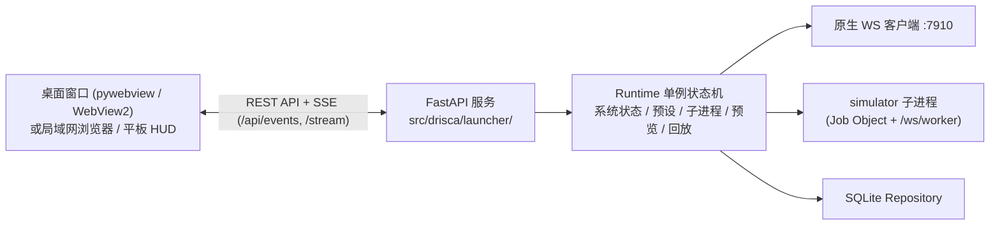

# 桌面管理端与 Web 架构

管理端 `launcher` 采用 **FastAPI 后端 + React/Tailwind/shadcn/ui 前端 + pywebview 无边框桌面壳** 的混合架构。桌面应用与局域网浏览器（平板 HUD、远程监控）共享同一套 HTTP/SSE/WebSocket 服务。

## 后端与前端分层

- **后端（`src/drisca/launcher/`）**：
  - `runtime.py`：统一维护 `SystemStatus` 单一状态机（未连接、已连接空闲、实验运行中、交通流预览中、录像回放中），通过 SSE 向前端广播状态、遥测与日志。
  - `replay.py`：`ReplayRunner` 负责录像回放调度，包含原生回放启停、按 `event` 表时间线自动同步环境/雾效变化，以及通过 `driving_view.update`（`actor_id_space="recorded"`）实现回放多视角与车辆切换。
  - `desktop.py`：基于 `pywebview` 承载无边框窗口（初始尺寸 `1200 × 780`），通过 Win32 `BeginInvoke` 将窗口八向缩放消息派发到 WinForms UI 线程，解决无边框窗口跨线程 `ReleaseCapture` 失效问题。
  - 优雅停机：退出时通过 `Runtime.close_streams()` 向所有 SSE 队列投递结束哨兵，确保 Uvicorn 快速干净退出。
- **前端（`frontend/`）**：
  - 技术栈：Bun、Vite、React、TypeScript、Tailwind CSS 与 shadcn/ui，构建产物输出至后端静态目录由 FastAPI 直接托管。
  - 页面组织：侧边栏按实验流程分为 **控制台**、**场景**、**天气**、**交通流**、**数据管理**、**主机配置**、**输入配置** 七页，使用 `useRememberedTab` 记住子标签选择。
  - 全局交互组件：顶部标题栏双胶囊承载预设管理与 CARLA 启停/连接弹窗；右上角 `RuntimeFloatingPanel` 在实验/预览/回放三种活动态下提供视角切换、切车与红色紧急停止；自由视角点击信号灯时弹出 `SignalControlCard`。
