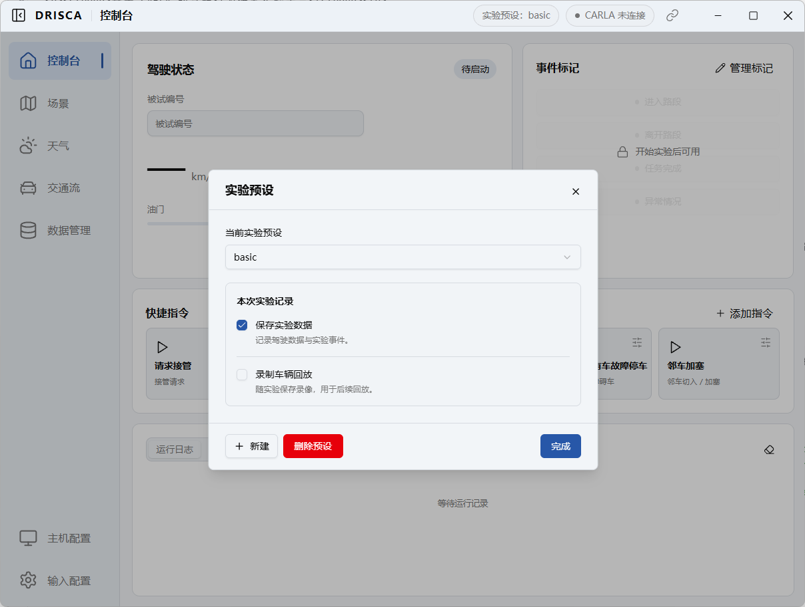
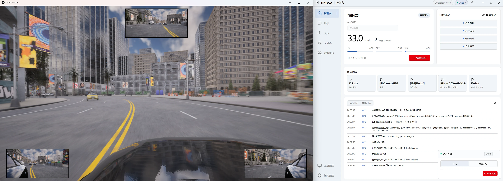

# 实验操作流程

管理端左侧菜单按实验顺序组织为七个页面：**控制台**、**场景**、**天气**、**交通流**、**数据管理**、**主机配置** 与 **输入配置**。本文说明一次标准实验从准备到收尾的完整操作。

## 1. 管理实验预设

一套实验方案（地图、车辆、天气、交通流、语音指令和打点标签）可以保存为一个**实验预设**，方便不同被试重复使用。

点击窗口顶部标题栏的预设下拉按钮，可以：

- 切换已有预设或新建、复制、删除预设。
- 勾选或取消 **保存数据**：正式实验保持开启，临时调试可关闭。
- 勾选或取消 **录像**：开启后会在实验期间自动录制 CARLA 录像文件，供事后回放分析。

## 2. 启动与监控实验

在 **控制台** 页面填写本次实验的 **被试编号**，确认顶部标题栏状态胶囊显示 CARLA 已连接后，点击 **开始实验**。

实验运行期间，控制台会实时展示：

- **运行遥测**：当前车速（km/h）、加速度、转向/油门/刹车输入、挡位、当前限速与所在道路信息。
- **快捷指令**：点击预设中配置好的指令按钮（例如“请求接管”），可立即下发对应动作并自动播报语音提示。
- **实验打点**：点击预设中的标记按钮（例如“进入路段”“异常情况”），系统会记录当前仿真时刻与帧号，随实验数据一起保存。
- **运行日志**：展示实验状态变化和异常提示；出现错误时可点击日志详情查看完整信息。

指令与打点按钮的内容可以在控制台对应区域直接增删修改并保存回预设。

## 3. 使用浮动控制面板

在实验运行、交通流预览或录像回放期间，管理端右上角会提供可折叠的**浮动控制面板**。即使你切换到天气、交通流等其他页面，也能随时执行高频操作：

- **视角切换**：在 **自由**、**车内**、**第三人称** 三种视角之间实时切换。
  - **车内视角**：显示主视图与三路后视镜，供被试正常驾驶。
  - **第三人称视角**：从车尾跟随观察车辆动态，支持在 CARLA 窗口用鼠标滚轮缩放距离、按住右键环视四周。
  - **自由视角**：自由漫游观察整个场景。
- **紧急停止**：点击面板上的红色停止按钮，可立即终止当前实验、交通流预览或录像回放。

## 4. 自由视角下的交互控制

当 CARLA 窗口处于**自由视角**时，可以直接用鼠标点击场景中的对象：

- **点击任意车辆**：高亮选中该车辆，查看其编号与状态。
- **点击路口红绿灯**：高亮选中对应信号灯，并在管理端弹出信号灯控制卡片，可直接手动切换红/黄/绿灯或冻结信号灯周期。

## 5. 平板 HUD 辅助显示

同一局域网下的平板或手机浏览器，访问管理端地址的 `/hud` 页面（例如 `http://<实验主机IP>:7900/hud`），即可作为独立仪表盘使用，实时显示当前车速、挡位、限速和自动驾驶状态。

## 6. 结束实验

点击 **停止实验**（或浮动面板中的红色停止按钮）后，系统会停止采集、保存剩余数据与录像，并弹出备注对话框。填写本次实验备注后确认，CARLA 窗口会自动恢复到自由视角，等待下一次实验。
