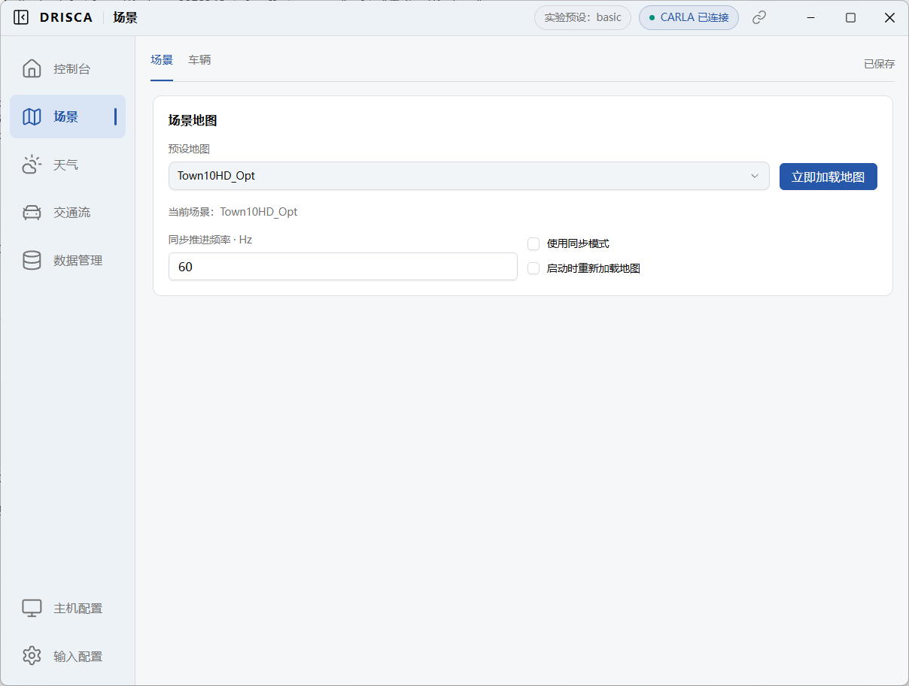
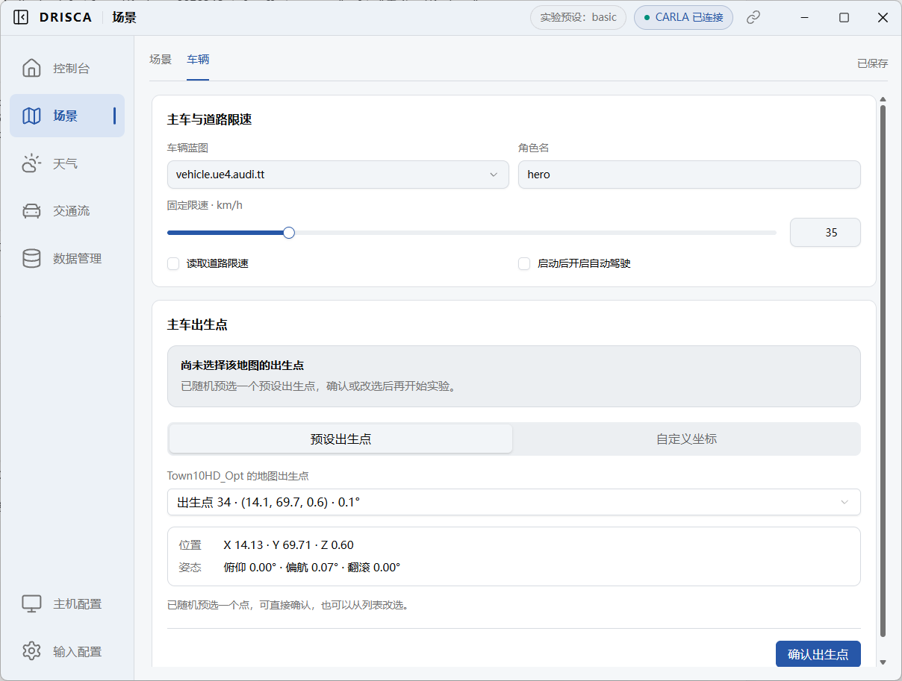
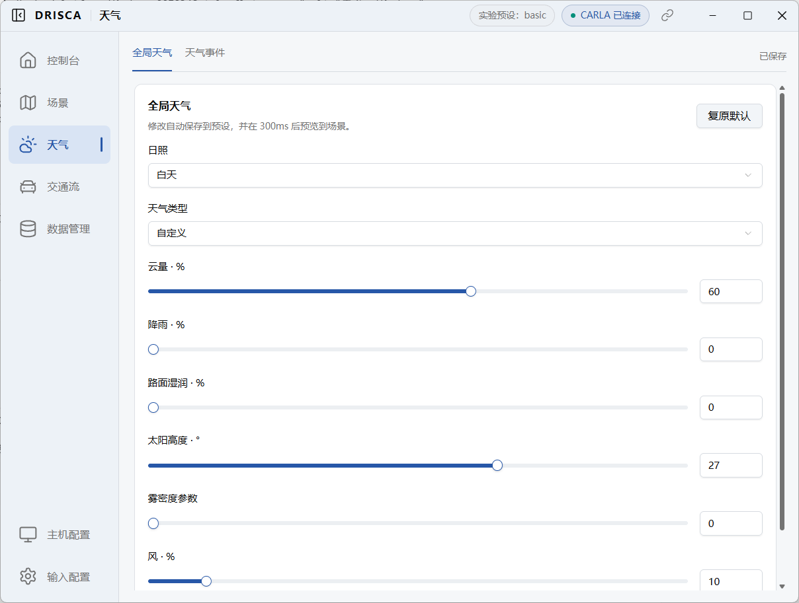
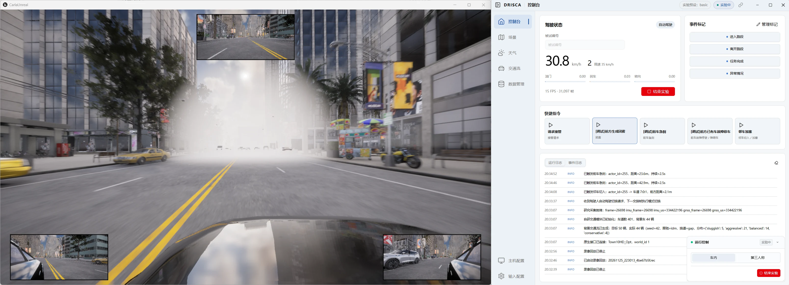
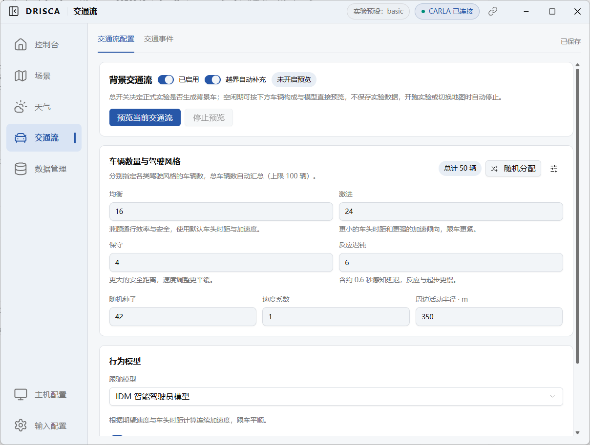
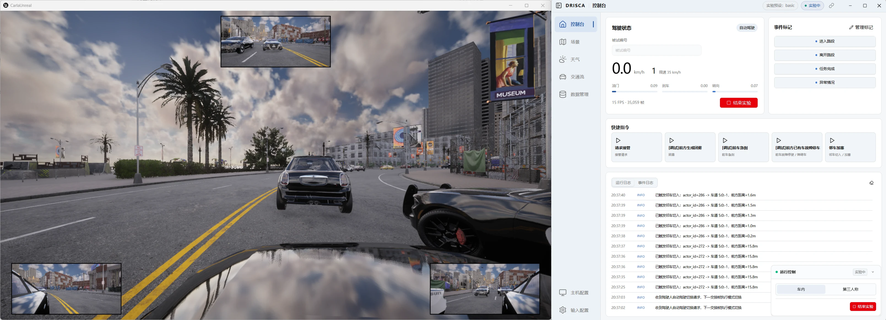
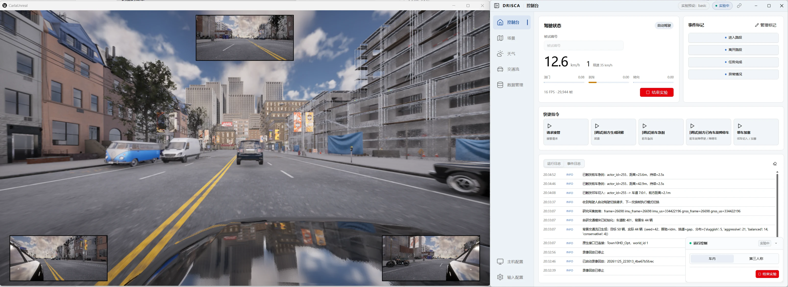

# 场景、天气与交通流

实验前可在左侧 **场景**、**天气**、**交通流** 三个页面分别配置静态方案，所有参数都会自动保存到当前选中的预设。实验运行期间，天气和交通流页面还会切换为可实时触发的运行期控制面板。

## 场景配置

在 **场景** 页面完成地图与主车的基础设置：

- **地图选择**：从当前 CARLA 已加载的地图列表中选择实验地图；勾选“重新加载地图”可在每次开始实验前彻底重置地图状态。
- **同步与帧率**：设置仿真推进频率（通常为 `60 Hz`）。
- **车辆蓝图**：连接 CARLA 后，从下拉列表选择主车车辆蓝图。
- **主车出生点**：支持三种方式确定主车出生点：
  1. 从当前地图自带的预设出生点列表中选择。
  2. 在 CARLA 窗口中把自由视角移动到目标位置，点击 **拾取当前位置**。
  3. 手动填写 `X / Y / Z` 坐标和 `Pitch / Yaw / Roll` 朝向角度。

切换地图后，在当前页面重新选择目标地图的有效道路出生点。

## 天气与局部雾效

在 **天气** 页面可以自由组合环境条件：

- **日照与天气独立组合**：太阳高度（白天、黄昏、夜晚）与天气类型（晴朗、多云、小雨、暴雨、浓雾）分开选择，可以轻松组合“夜间暴雨”“黄昏大雾”等场景。
- **精细参数调节**：支持调节云量、风力、降雨量、路面湿滑与积水、全局雾浓度（0–100）、起雾距离以及太阳方位角。
- **局部球雾区域**：除了全局雾，还可以按世界坐标添加多个球形局部雾区（设置中心位置、半径、雾密度和渐入时长），适合构建“驶入团雾路段”的实验任务。
- **运行期事件**：实验进行中可在页面直接调整天气并指定平滑过渡秒数，或一键触发“突发阵雨”等环境事件。

## 背景交通流与交互事件

在 **交通流** 页面可以配置实验中的背景车辆：

### 基础参数

- **启用交通流**：打开后，实验开始时自动在主车周边及道路网中生成背景车辆。
- **驾驶风格分布**：按四种风格分别指定车辆数量——**平稳（balanced）**、**激进（aggressive）**、**保守（conservative）**、**缓慢（sluggish）**。系统会根据设定风格自动分配跟车间距、期望车速和变道倾向。
- **周边活动半径（`active_radius_m`）**：以主车为中心维护活动交通圈；超出半径的背景车辆自动回收，并在主车前方及周边道路重新补充，保持有效车流密度。
- **行为多样性与随机种子**：填写固定随机种子可复现相同的车流分布；调节多样性参数可让同风格车辆之间产生自然差异。
- **变道与开放地图保护**：可开关背景车自主变道；在边界开放的自定义地图中，开启“掉落自动重生”可自动回收并补充驶出边界的车辆。

### 交通流预览

点击交通流页面的 **启动预览**，可在 CARLA 窗口中直接观察当前车流参数的效果；确认后点击停止预览即可进入正式实验。

### 运行期场景触发与车流调节

实验或预览运行期间，操作者可以在交通流页面实时调整周边目标车流数量，或一键触发七类预设交互场景，所有触发动作都会自动记录为实验事件：

| 场景事件 | 效果说明 |
| --- | --- |
| **前车急刹** | 挑选主车前方同车道车辆执行紧急制动并点亮刹车灯，测试被试追尾避险反应 |
| **旁车切入** | 支持复用相邻车道已有车辆，或在前方邻道带初速度生成车辆向主车前方强制加塞切入 |
| **后车超车** | 在后方复用或生成车辆变道加速超越主车，支持配置超越后是否切回主车车道 |
| **前车故障** | 支持复用前方已有车辆停驶开双闪，或在前方同车道远距生成低速/静止障碍车 |
| **前方信号变灯** | 控制主车前方即将经过的路口信号灯切换为黄灯或红灯 |
| **双车道缓行** | 让主车前方与邻车道车辆同步降速，形成拥堵缓行场景 |
| **闯红灯车辆** | 在前方交叉口触发横向来车无视红灯驶入路口 |

