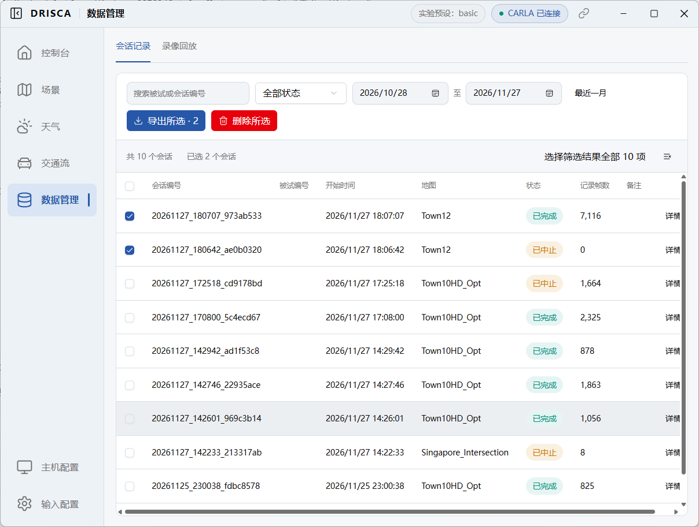
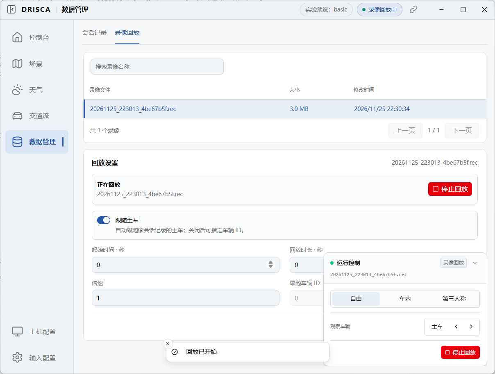

# 数据导出与录像回放

开启 **保存数据** 后，每次实验的所有记录都会自动保存到本地数据库。你可以在左侧 **数据管理** 页面浏览历史实验、导出分析表格以及在 CARLA 中回放录像。

## 浏览历史实验与导出 CSV

在 **数据管理** 页面可以看到全部历史实验会话列表，包含会话编号、被试编号、使用地图、开始时间、持续时长、录像状态与实验备注。

- **查看详情**：点击任意一条会话，可查看本次实验记录的主车采样条数、背景车采样条数和实验事件列表。
- **导出 CSV**：点击 **导出** 按钮，系统会在导出目录生成本次会话对应的 CSV 文件：
  - `data.csv`：主车逐帧运动状态（位置、姿态、速度、加速度、油门/刹车/转向输入、IMU、GNSS、车道偏移与碰撞强度等）。
  - `traffic.csv`：同帧记录的背景车辆位置、速度、车道与控制状态。
  - `events.csv`：实验期间触发的所有离散事件（接管请求、语音播报、手动打点、天气变化、场景触发等）。
- **打开导出目录**：点击页面上的 **打开导出目录** 按钮，可直接用 Windows 文件资源管理器打开导出文件夹。

导出表格中的速度单位统一为 **m/s**（如需换算为 km/h，乘以 `3.6` 即可）。浮点数值默认保留 6 位小数，时间戳和 GNSS 经纬度保留原始精度。

## 录像回放与多视角观察

如果实验时勾选了 **录像**，会话详情中会显示 **回放** 按钮。确保 CARLA 已连接后点击 **回放**，CARLA 窗口会立即加载对应地图并重演整段实验过程：

- **环境自动同步**：回放期间，系统会自动按当时记录的事件时间线同步还原天气、雾效和局部球雾变化。
- **多视角切换**：通过右上角浮动面板，随时在 **自由**、**车内**、**第三人称** 三种视角间切换，观察主车驾驶画面或全局车流态势。
- **切换跟随车辆**：点击浮动面板中的 **主车**、**上一辆**、**下一辆** 按钮，可以在主车与任意背景车之间自由切换观察目标。
- **停止回放**：点击浮动面板上的红色停止按钮可随时结束回放，CARLA 窗口会自动回到高空自由视角。

