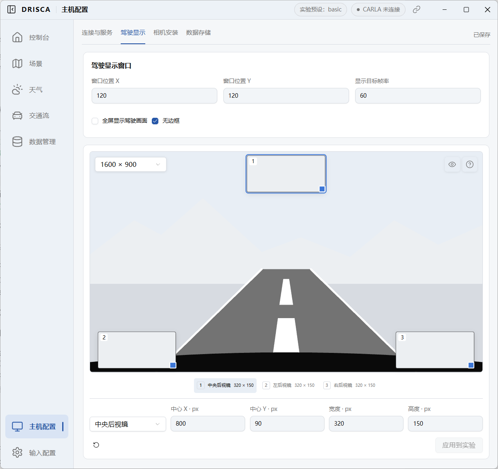
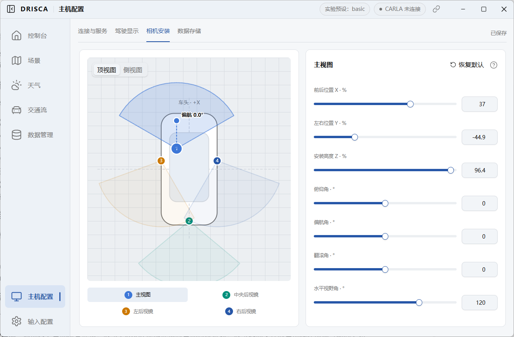

# 主机与输入配置

与硬件主机和外设相关的设置集中在左侧 **主机配置** 与 **输入配置** 两个页面，通常只需在更换实验电脑或调整显示器布局时修改一次。

## 主机配置

**主机配置** 分为四个标签页：

### 连接与服务

- **CARLA 运行程序**：选择使用“独立发布版 (Shipping)”或“编辑器模式 (Editor)”，并填写对应的可执行文件或工程文件路径；支持设置画面质量等级（如 `Medium`、`High`）和启动超时时间。
- **端口配置**：本机运行保持默认端口即可：
  - CARLA RPC 端口：`2000`
  - 控制服务端口：`7910`
  - 管理端 Web / 平板 HUD 端口：`7900`（监听 `0.0.0.0`，方便同局域网平板访问）
- **语音播报与调试日志**：可在此开启或关闭系统语音播报（TTS）以及详细调试日志。

### 驾驶显示

设置 CARLA 驾驶窗口的分辨率、屏幕左上角坐标（支持负坐标，用于将窗口定位到主屏左侧的副屏）、全屏或无边框模式，以及显示目标帧率。

> 修改窗口尺寸或运行版本后，需重新启动 CARLA 窗口才能生效。

### 相机安装

在此调整车内主视图及左、中、右三路后视镜的相对安装位置、俯仰/偏航角、视野（FOV），以及后视镜在屏幕上的显示位置、尺寸和边框样式。

### 数据存储

设置数据库文件、录像文件夹与 CSV 导出文件夹的保存路径。填写相对路径时默认以 DRISCA 项目目录为起点。

## 输入配置

在 **输入配置** 页面可以查看和修改驾驶按键绑定：

- **键盘驾驶**：默认使用 `W / A / S / D` 控制油门、刹车与转向，`Q` 切换倒挡，`Space` 切换手刹，`M` / `,` / `.` 控制手动换挡；点击对应动作即可重新绑定按键或设为未绑定。
- **方向盘配置**：页面保留了方向盘设备编号和按键映射配置，供后续接入外接方向盘硬件时使用；当前键盘驾驶模式下保持方向盘未启用即可。

## 配置文件位置（参考）

所有界面设置都保存在项目根目录的 `configs/` 文件夹中，支持备份或复制到其他主机复用：

- `configs/machine.toml`：主机连接、显示、相机布局与数据目录设置。
- `configs/control.toml`：键盘与方向盘按键绑定。
- `configs/presets/*.toml`：各个实验预设文件。
