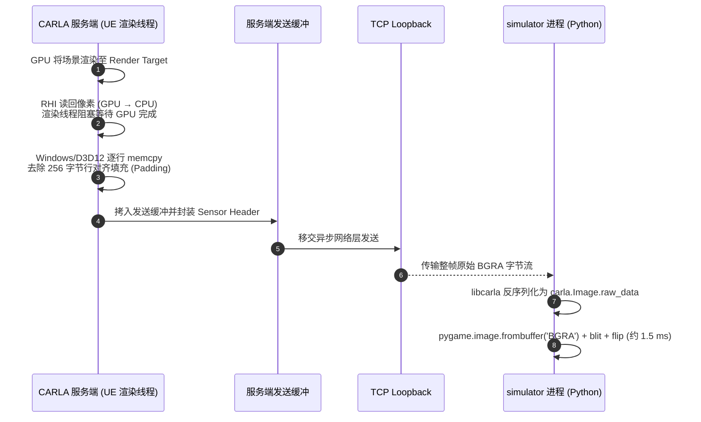

# 渲染与画面传输参考

本文作为渲染专题参考，保留画面传输图、已有测量和技术路线分析。主线设计采用 CARLA 相机取图与 pygame-ce 合成，实施顺序见[开发路线图](../design/06-Roadmap.md)。以下测量用于解释选型背景，实际表现随实验环境检查。

## 核心结论

CARLA 的弹簧臂安装适合平滑的车外跟随镜头，`SpringArmGhost` 允许镜头穿过遮挡物。驾驶位与后视镜采用刚性安装，镜头相对车辆保持固定。安装类型的说明见 [CARLA 传感器文档](https://carla.readthedocs.io/en/latest/core_sensors/)。

当前系统采用服务端渲染、客户端取像素的方式：三维世界在 CARLA 服务端（UE4）的 GPU 中渲染，每帧相机画面被回读到服务端 CPU 内存、序列化后经本地 TCP 回环发给 Python 客户端（`simulator`），再由 `simulator` 合成绘制到窗口。这一结构与云游戏相近，但传输的是未经编码的原始像素，本文统一用「服务端渲染、客户端取像素」称呼。

实测表明，客户端绘制环节在去掉冗余通道重排后耗时 `1.5 ms`（占 60Hz 单帧预算 `16.7 ms` 的 9%），主要开销集中在服务端渲染线程的 GPU 回读等待与每秒约 500 MB 的数据搬运。在不维护私有 CARLA UE4 C++ 分支的前提下，客户端侧的优化空间有限。

## 单帧画面的完整数据路径

以主车搭载的一路 RGB 相机传感器为例，从物理帧推进到画面可见依次经过以下 8 个步骤：

### 为什么无法在客户端跳过回读或直接共享显存？

CARLA 采用跨机器通用的客户端与服务端架构，传感器模块（`SceneCaptureCamera.cpp` → `FPixelReader::SendPixelsInRenderThread`）在设计上默认客户端可能运行在另一台物理机器上，因此会在服务端渲染线程内把像素从显存读回内存并打包进 TCP 流。

当 Python 客户端的 `sensor.listen(callback)` 收到数据时，图像已经是一段位于普通 CPU 内存中的 `bytes`（`raw_data`）。客户端拿不到服务端纹理的共享显存句柄，也无法阻止服务端发生回读。

### 性能开销主要集中在哪里？

以 1920×1080 主视图 + 3 路 384×180 后视镜（60Hz）计算，单帧原始像素体积约 `9.1 MB`，每秒经 `127.0.0.1` 传输超过 `500 MB`。预设中后视镜的默认尺寸为 320×150，像素量相差很小，不影响下面的结论。性能损耗主要来自两处：

1. 服务端渲染线程同步等待 GPU 回读：每增加一路高分辨率相机，UE 渲染线程在 `ReadSurfaceData` 处的阻塞等待就越久，进而拖慢服务端推进世界帧的速度。
2. 多次内存拷贝：在进入客户端绘制逻辑之前，单帧 8~9 MB 数据已经在服务端经历了 D3D12 去对齐逐行拷贝、发送缓冲拷贝、Socket 发送与接收共 3~4 次内存搬运。

## 为什么更换客户端渲染引擎（如 OpenGL / pyglet）更慢？

在相同分辨率（1080p 主视图 + 3 路后视镜，120 帧均值）下，对不同客户端绘制方案的实测对比如下：

| 客户端渲染实现 | 单帧总耗时 | 关键环节耗时拆解 |
| --- | --- | --- |
| 旧版 `pygame` 写法：`camera_to_array` + `array_to_surface` | `7.58 ms` | `raw[..., [2, 1, 0]]` 通道重排 `2.0 ms` + RGB24 转 32 位 Surface `2.7 ms` |
| 新版 `pygame-ce` 写法：`pygame.image.frombuffer(..., 'BGRA')` | `1.47 ms` | 直接映射原始 BGRA 缓冲，仅发生窗口 Surface 内存合成 |
| 替换引擎：`pyglet` OpenGL 纹理上传（`glTexSubImage2D`） | `3.35 ms` | 每帧将 8.3 MB 数据从 CPU 内存经 PCIe 总线上传至显存固定耗时 `1.31 ms` |

原因主要有两点：

1. 旧版 `pygame` 的耗时集中在 NumPy 数组重排：CARLA 原始字节流为 `BGRA` 排列，而旧代码使用的 `surfarray.array_to_surface` 只接受三维 `(W, H, 3)` 的 `RGB` 数组，每帧都需要做一次切片重排与格式转换，消耗了 `4.7 ms`。改用 `pygame-ce 2.5+` 原生支持的 `pygame.image.frombuffer(buffer, size, 'BGRA')` 后，这部分开销随之消除。
2. OpenGL 路线多付了一次 PCIe 上传代价：由于数据到达客户端时已经在 CPU 内存中，使用 OpenGL 渲染需要把服务端刚从 GPU 读回 CPU 的 8.3 MB 数据，再通过 `glTexSubImage2D` 重新传回 GPU 显存。在没有客户端着色器后处理需求的情况下，直接在 CPU 内存完成合成并交由窗口系统显示更快。

## 潜在的服务端优化方向与取舍

如果未来实验场景规模扩大，相机回读成为硬瓶颈，有以下四条路线可选（前三条均需修改并重新编译 CARLA 的 UE4 C++ 源码）：

### 服务端软件压缩（JPEG）后发送

- 原理：在服务端 `PixelReader.h` 入队发送前调用 UE 内置的 `IImageWrapper` 进行 JPEG 压缩。单帧体积可从 `8.3 MB` 降至 `328 KB`（q85）。
- 实测结论（本地回环不划算）：1080p 单帧软件 JPEG 编码耗时 `3.6 ms`，客户端解码耗时 `5.5 ms`，合计 `9.1 ms`，高于直接传裸数据的 `1.5 ms`；且服务端 GPU → CPU 回读耗时基本没有减少。仅在跨物理机器低带宽传输时有意义。

### 服务端硬件视频编码（NVENC / Pixel Streaming）

- 原理：利用显卡硬件编码器（NVENC / AMF）在显存内直接编码并推流（如 UE4 自带的 Pixel Streaming 插件）。
- 局限：Pixel Streaming 默认推送的是 UE 主视口而非独立传感器相机；改造传感器接入硬件编码同样需要修改 UE 插件，且会引入 20~40 ms 的编解码管线延迟，同机运行得不偿失。

### 服务端写入 Windows 共享内存（Shared Memory）

- 原理：在 `PixelReader.h` 中仿照 `WITH_ROS2` 分支，将像素直接写入本地命名共享内存，跳过序列化与 TCP loopback。
- 局限：只能省去网络栈的 2 次内存拷贝，GPU → CPU 渲染线程回读依然存在，收益与维护自定义 UE 分支的成本不成正比。

### 不改 UE 源码的折中手段：借用 UE Spectator 窗口做主视图

- 原理：将 CARLA 服务端自身的窗口观察者（`spectator`）实时绑定到主车驾驶位作为全屏主视图，`simulator` 进程只挂 3 个小分辨率后视镜相机。可减少约 87% 的回读像素量。
- 局限：`spectator` 视口不支持传感器级别的镜头参数与自定义后处理；后视镜与主视图分属两个进程窗口，全屏叠放与方向盘、键盘输入焦点管理容易出错。

## 为什么现阶段不修改 UE 服务端源码？

修改 `PixelReader.h` 的主要阻力在于工程维护与分发成本：

1. 构建环境庞大：需要拉取数十 GB 的 CARLA 定制版 UE4 引擎源码，配置特定版本的 Visual Studio 工具链，预留约 200 GB 磁盘空间，单次编译耗时数小时。
2. 分发负担重：一旦修改服务端插件，使用者无法再直接下载官方预编译包，必须自行打包并分发数十至上百 GB 的服务端程序。
3. 升级维护成本高：后续跟进上游 CARLA 版本升级时需持续合并私有分支。

### 真机瓶颈验证方法

在真机上怀疑相机拖慢帧率时，可用控制变量法测量：

1. 将主车所有相机传感器全部 `destroy()`，空跑物理推进循环记录基准帧率。
2. 依次加回 3 路小分辨率后视镜相机和 1 路 1080p 主视图相机，记录每增加一路后的帧率变化。

当实测证实挂上 1080p 主相机占用了超过 30% 的帧时间时，再考虑启用 Spectator 主视图或评估服务端改造。

## 关键源码参考索引

| 路径 | 说明 |
| --- | --- |
| `Unreal/CarlaUE4/Plugins/Carla/Source/Carla/Sensor/SceneCaptureCamera.cpp` | CARLA C++ 相机传感器入口，每物理帧后触发 `SendPixelsInRenderThread` |
| `Unreal/CarlaUE4/Plugins/Carla/Source/Carla/Sensor/PixelReader.h` | 服务端 RHI 像素回读、D3D12 逐行去对齐拷贝、头部序列化与 Socket 发送实现 |
| `src/drisca/simulator/sensors.py` | 客户端接收 `carla.Image` 并缓存最新的传感器帧 |
| `src/drisca/simulator/renderer.py` | 客户端用 `frombuffer` 合成主视图与后视镜并上屏 |
